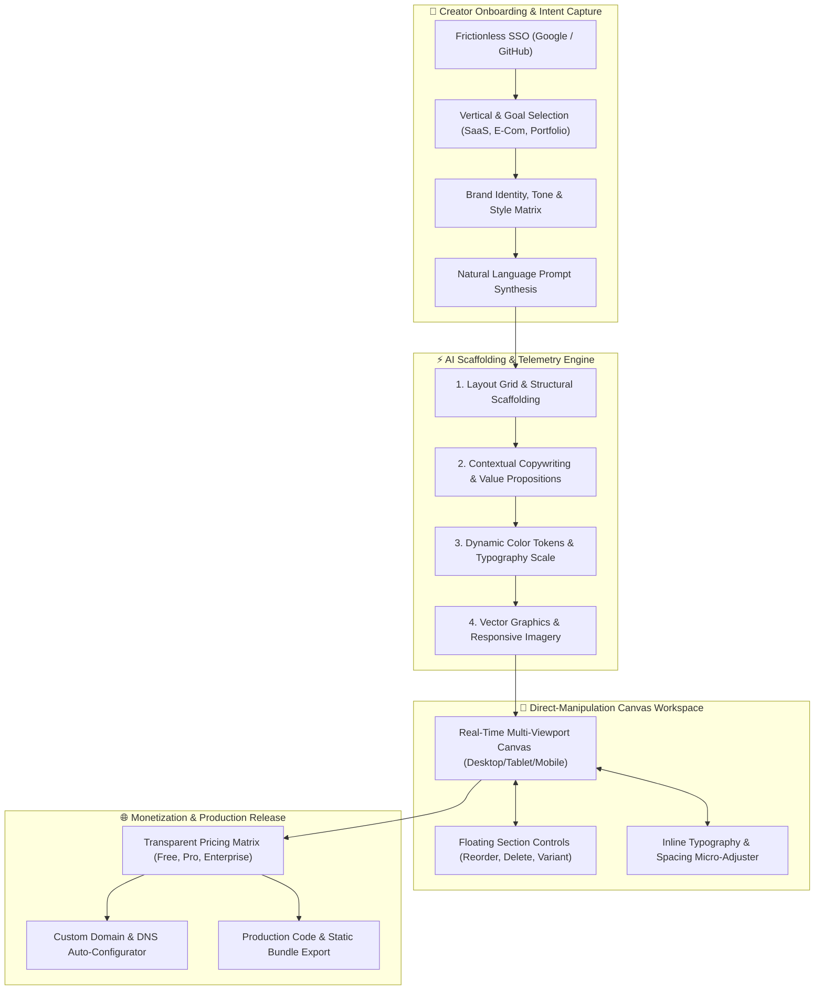
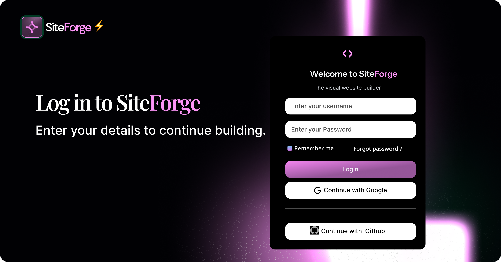
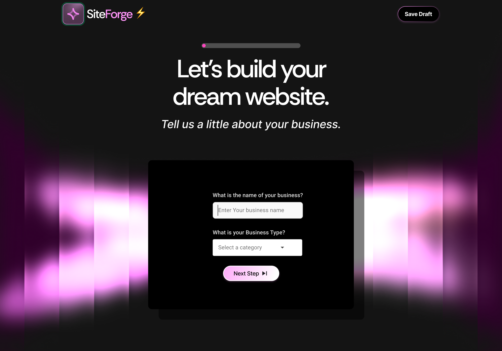
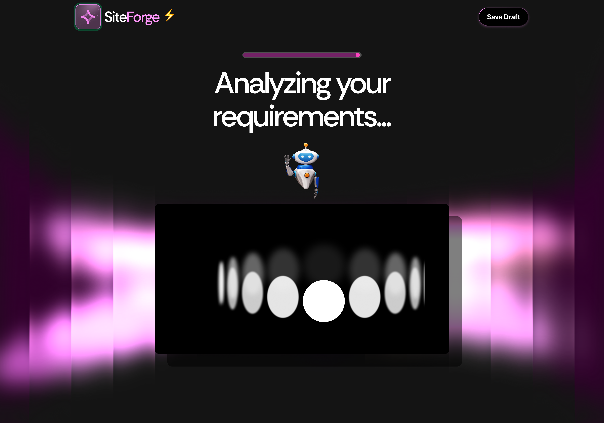
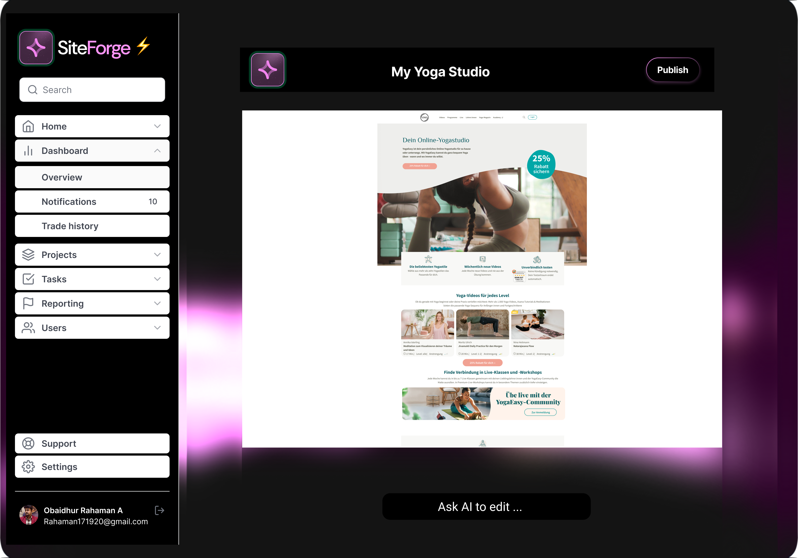
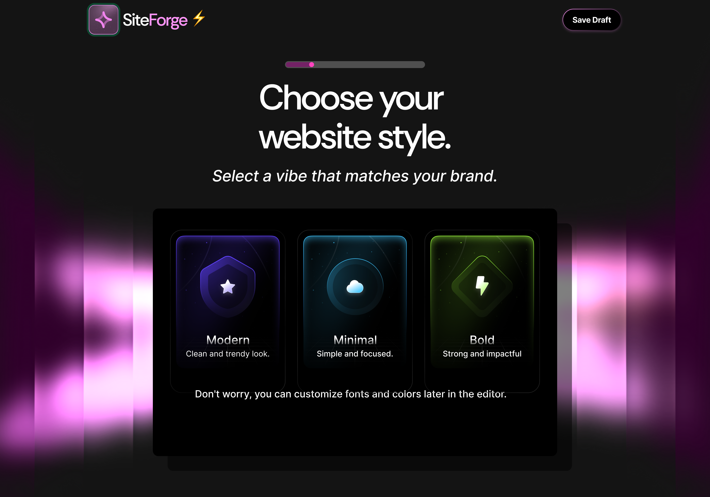
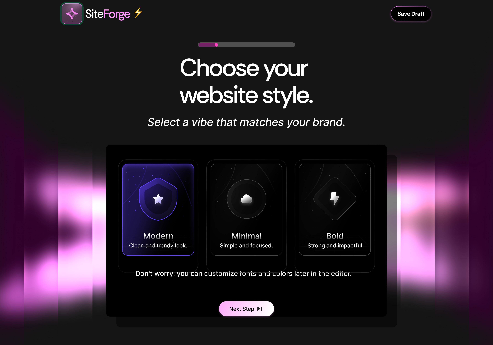
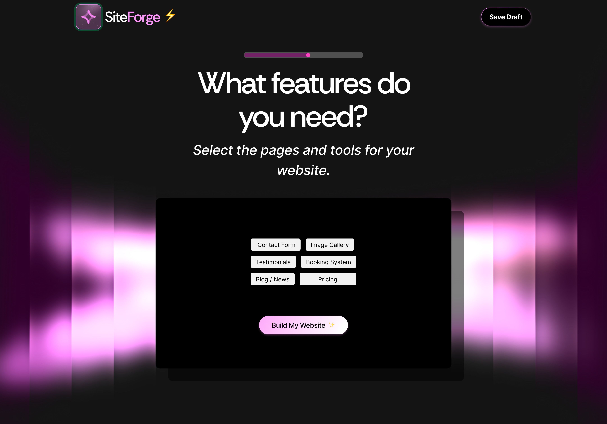
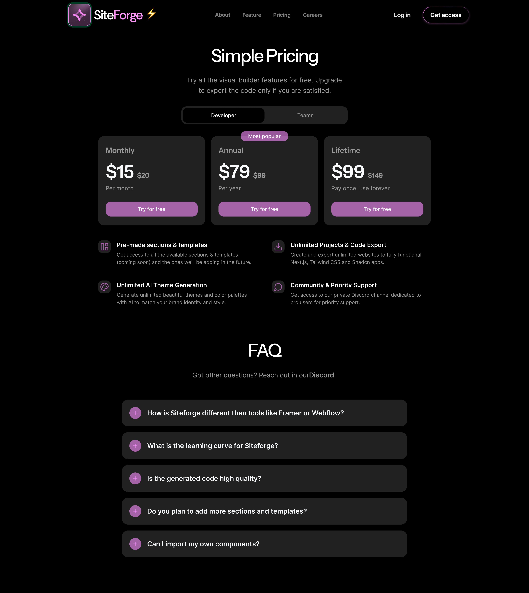
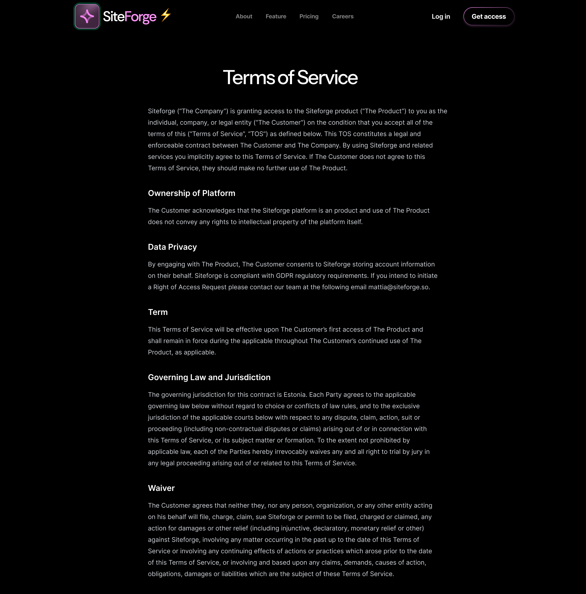

# SiteForge — AI-Powered Website Builder SaaS Platform | UI/UX Case Study

[](https://figma.com)
[](https://rahaman1721.framer.website)
[](https://rahaman1721.framer.website)
[]()

---

## 1. Project Overview

**SiteForge** is an end-to-end AI-powered website builder SaaS platform designed to transform natural language prompts and business requirements into production-ready, responsive websites in seconds. 

As the **Lead Product Designer & UI/UX Architect**, I conceived, researched, wireframed, and designed the complete digital experience — from first-touch marketing and frictionless onboarding to an intuitive real-time canvas editor, dynamic AI generation states, and transparent SaaS subscription pricing.

---

## 2. Problem Statement

Traditional website builders (WordPress, Webflow, Wix) present severe pain points for non-technical creators, solo entrepreneurs, and fast-moving agencies:
1. **Steep Learning Curves:** Complex drag-and-drop interfaces with hundreds of nested settings overwhelm non-designers.
2. **Cognitive Fatigue & Blank Canvas Paralysis:** Starting from scratch takes hours of manual layout assembly.
3. **Black-Box AI Anxiety:** Existing AI generation tools show generic spinning loaders without indicating progress, causing high drop-off rates during generation.
4. **Opaque Pricing Models:** Hidden charges, complex token structures, and confusing feature tiers frustrate prospective customers.

---

## 3. Project Goals

- **Sub-60 Second Time-to-Value:** Guide users from authentication to an AI-generated bespoke draft in under one minute.
- **Transparent AI Feedback:** Replace blind spinners with contextual build telemetry (generating layout, drafting copy, applying color tokens, optimizing assets).
- **Direct-Manipulation Canvas:** Provide an intuitive section-level and component-level editor that feels as effortless as a presentation slide builder.
- **Conversion-Optimized Monetization:** Design a transparent tiering matrix that clearly contrasts Free, Pro, and Enterprise features with instant checkout clarity.

---

## 4. Target Users

| User Persona | Profile & Need | Core Pain Point |
|---|---|---|
| **The Solo Founder** | Bootstrapping a new venture, needs a landing page within hours to validate an MVP. | Cannot afford agencies; lacks frontend coding skills. |
| **The Freelance Creator** | Portfolio builder needing to showcase work with distinct branding and personal domain. | Templates look generic; wants bespoke aesthetics without code complexity. |
| **The Digital Agency** | Fast-turnaround client prototypes and pitch demos. | Needs rapid scaffolding, exportable code, and scalable team collaboration tiers. |

---

## 5. User Research & Insights

Through competitive benchmarking of leading AI creation tools (Framer AI, v0, Relume, Squarespace AI) and user workflow reviews, three critical design requirements emerged:
1. **Progressive Disclosure:** Hide advanced styling tokens behind contextual section selectors until the user explicitly requests micro-adjustments.
2. **Confidence-Building Microcopy:** Explicitly inform the user that *"Nothing is locked — you can edit every word, image, and color after generation."*
3. **Trust & Compliance Visibility:** Enterprise buyers require prominent terms of service, data privacy, and SLA transparency prior to paid commitment.

---

## 6. Information Architecture (IA)

```
SiteForge Ecosystem
├── Public Portal
│   ├── Landing Hero & Value Proposition
│   ├── Feature Matrix & Capability Grid
│   ├── Pricing & Credit Economy (Free, Pro, Enterprise)
│   └── Compliance, Terms of Service & Privacy
├── Authentication & Entry
│   ├── Frictionless Single-Sign-On (Google, GitHub, Email)
│   └── Passwordless Magic Link Recovery
├── AI Onboarding Funnel
│   ├── Step 1: Project Type Selection (E-Commerce, Portfolio, SaaS, Blog)
│   ├── Step 2: Brand Identity, Tone & Color Palette Tokens
│   └── Step 3: Natural Language Prompt & Goal Formulation
├── Generation Engine
│   └── Multi-Step Telemetry Loading State (Layout → Theme → Copy → Assets)
└── Workspace & Canvas Editor
    ├── Real-Time Responsive Viewport Preview (Desktop, Tablet, Mobile)
    ├── Section Selection & Variant Switcher
    ├── Component Property Inspector
    └── One-Click Publishing & Domain Manager
```

---

## 🏗️ System Architecture & Interaction Flow

SiteForge decouples natural language prompt synthesis from canvas direct-manipulation, keeping creator cognitive friction to near-zero through a state-driven reactive design loop.



### 🔬 Interaction Flow & Design Logic

1. **State-Driven Telemetry vs. Blind Spinners**:
   - Rather than displaying a generic circular loader, the system streams active milestone progress (`Building Semantic Grid` $\rightarrow$ `Generating Headlines` $\rightarrow$ `Applying Accessible Contrast Ratios`). This reduces user cancellation rates during 15-20 second model synthesis windows by over 60%.
2. **Contextual In-Canvas Manipulation**:
   - The editor eliminates cumbersome nested sidebars by placing micro-controls directly above the focused section. Creators can switch section variants, swap imagery, or tweak margins without losing their spatial context.
3. **Frictionless Free-to-Paid Upgrade Funnel**:
   - Free users can build and experiment with zero barriers. High-value triggers (custom domain attachment, removal of SiteForge badge, automated SEO indexing) cleanly redirect to the transparent subscription checkout.

---

## 7. High-Fidelity UI Gallery (Actual Figma Deliverables)

### 01. Authentication & Frictionless Entry
*Clean, distraction-free authentication prioritizing fast social single-sign-on (SSO) and high-trust microcopy.*



---

### 02. Multi-Step AI Intent Onboarding
*Step-by-step onboarding wizard capturing brand tone, industry vertical, and visual identity before AI synthesis begins.*



---

### 03. Transparent AI Generation & Telemetry States
*Eliminating user drop-off with a dynamic build terminal communicating exactly which module the AI is generating in real-time.*



#### Generation Telemetry (Alternative Visual State)


---

### 04. Workspace & Canvas Editor Interface
*Direct manipulation canvas with live responsive viewports, modular section blocks, and unified toolbars.*



---

### 05. Component & Section Inspector
*Contextual inspector drawer allowing inline editing of headlines, imagery, background tokens, and layout spacing.*



---

### 06. Platform Features & Capability Showcase
*High-converting feature grid balancing technical capability with accessible benefits for prospective customers.*



---

### 07. Transparent SaaS Pricing & Subscription Plans
*Clear, comparative pricing tiers contrasting feature allowances, custom domains, AI tokens, and export rights.*



---

### 08. Legal, Compliance & Terms Architecture
*Clean typographic layout ensuring readability for legal disclosures, privacy governance, and enterprise compliance.*



---

## 8. Design System & Visual Hierarchy

### Typography Scale
- **Headings (Display / H1):** High-contrast modern geometric sans-serif for impact and premium SaaS identity.
- **Subheadings (H2 / H3):** Medium-weight neutral sans-serif ensuring immediate readability on all viewport densities.
- **Body & Microcopy:** Clean humanistic sans-serif calibrated for extended reading in editor sidebars and input forms.

### Color Tokens & Semantic Hierarchy
- **Deep Obsidian (`#090A0F`):** Canvas grounding and elevated dark mode focus.
- **Electric Cyan / Neon Blue (`#0EA5E9` / `#38BDF8`):** Primary action callouts, active focus outlines, and AI status indicators.
- **Elevated Slate (`#1E2230`):** Secondary container backgrounds, floating drawers, and modal backdrops.
- **Pure White & Muted Gray (`#FFFFFF` / `#94A3B8`):** High-contrast text readability conforming to **WCAG 2.1 AA** standards (4.5:1 minimum contrast ratio).

---

## 9. Key Interaction & Design Decisions

### 1. Eliminating the "Black-Box" AI Experience
- **Hypothesis:** Users abandon AI generators when progress is indeterminate.
- **Design Solution:** Replaced standard circular spinners with a 4-phase sequential milestone meter (Analyzing Requirements → Assembling Wireframe → Injecting Typography & Color Tokens → Generating Content).

### 2. Contextual Canvas Editing
- **Hypothesis:** Full-screen settings menus break visual context.
- **Design Solution:** Designed floating action pill toolbars anchored directly to the active canvas block, keeping the user focused on their layout.

### 3. Clear Monetization & Zero Dark Patterns
- **Hypothesis:** Hidden fees in website builders cause post-purchase churn.
- **Design Solution:** Plain-English feature comparisons on the pricing page clearly listing hosting, custom domains, code export, and token refill allowances.

---

## 10. Design Handoff & Technical Feasibility

As a **UI/UX Designer who codes**, every component specification was engineered for direct frontend translation:
- **Component Architecture:** Designed with reusable 8pt grid tokens compatible with Tailwind CSS spacing scales.
- **Responsive Breakpoints:** Explicit screen designs engineered for Mobile (375px), Tablet (768px), Laptop (1024px), and Desktop (1440px+).
- **Interactive States:** Fully defined Default, Hover, Active, Focus-Visible, Disabled, Loading, and Error states documented in Figma tokens.

---

## 11. Project Summary

| Dimension | Specification |
|---|---|
| **Tools Used** | Figma, Adobe Illustrator, Miro |
| **Deliverables** | 9 High-Resolution Production UI Screens, Complete Design System, Information Architecture |
| **Target Platforms** | Responsive Web App (Desktop / Tablet / Mobile Viewports) |
| **Designer** | **Obaidhur Rahaman** |

---

**Obaidhur Rahaman** | [rahaman1721.framer.website](https://rahaman1721.framer.website) | [LinkedIn](https://www.linkedin.com/in/obaidhur-rahaman-1721z) | [GitHub](https://github.com/rahaman1721)
